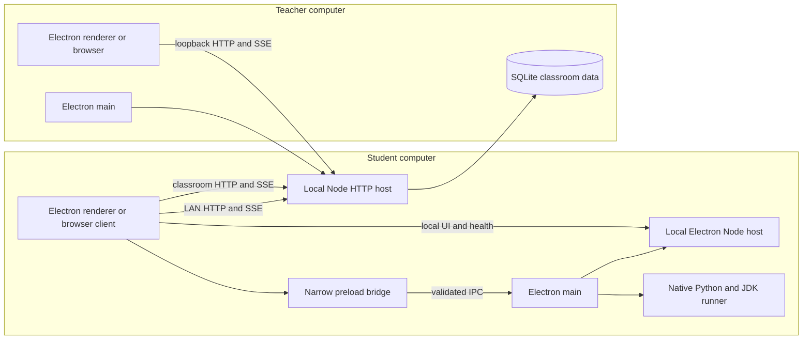

# CodeMesh architecture — v1.0 release candidate

This document describes the current source implementation. The supplied
architecture specification and roadmap also describe future options; those
are not treated as implemented unless they appear here and in the source.

## Component and trust boundaries

`apps/desktop/src/main/electron.cjs` creates a sandboxed BrowserWindow with
context isolation enabled and Node integration disabled. It starts the
classroom server in Electron's bundled Node utility process. The packaged
utility process uses Electron's writable user-data directory as its working
directory; classroom data itself is stored separately under the OS user's
`~/.codemesh` directory.

`apps/desktop/src/preload/index.cjs` exposes desktop metadata and the narrow
`runNativeCode` IPC method. The main process checks the sender frame and
validates the execution request before calling
`apps/desktop/src/main/native-runner.cjs`. The renderer does not receive
general Node or filesystem access.

The host serves the React-built shell and renderer bundle plus locally built
Monaco editor, language, CSS, and worker assets. Teacher controls are
loopback-only. Students connect to the teacher's LAN address over HTTP and
receive a personal workspace after teacher approval.

## Classroom and persistence model

`apps/desktop/src/main/server.mjs` owns the HTTP API, SQLite persistence,
network-interface discovery, join/admission workflow, workspace and
submission operations, and server-sent event fan-out. The current database
schema is:

| Table | Stored fields and purpose |
| --- | --- |
| `sessions` | Session id, name/topic, join code, status, creation time, editor lock, and published exercise JSON |
| `join_requests` | Request id, session id, student-entered name/roll number, admission status/time, and token hash |
| `workspaces` | Student id, workspace files as JSON, and last update time |
| `submissions` | Submission id, student id, exercise title, submitted files as JSON, and submission time |

Workspace and submission content is stored in SQLite JSON records. User data
is not placed in the install directory and the installer is configured to
preserve it on uninstall. See [API contracts](api-contracts.md) for current
routes and event payload rules.

## Network and events

The host uses HTTP request/response routes and Server-Sent Events (SSE). SSE
messages use a versioned validated envelope. Student event streams
authenticate with bearer tokens in the Authorization header; query-string
tokens are rejected. Clients reconnect with bounded backoff and retrieve an
authoritative session or workspace snapshot after reconnect. The host does
not keep an event replay log. SSE remains in use because no representative
LAN evidence currently justifies a transport change.

Traffic is unencrypted HTTP. Join codes and teacher approval reduce casual
access but do not encrypt traffic or verify student identity. Use only on a
trusted controlled LAN. Do not expose the host directly to the public
internet.

## Student code execution

In Electron desktop mode, the student's own computer runs Python or Java via
installed local runtimes. The main process stages files in a temporary
directory, invokes allowlisted executables without a shell, enforces time and
output limits, and cleans up the temporary directory. Python and the
supported Java source-file subset run with the logged-in user's OS
permissions. These controls are not a sandbox; untrusted or high-stakes code
needs an OS isolation boundary that this application does not provide.

Browser Python is a separate optional Pyodide path that requires local
Pyodide assets. Browser Java/TeaVM is not wired into the current build.
Electron desktop execution does not use Pyodide or TeaVM.

## Implemented boundaries and open validation

- The renderer and classroom-critical runtime assets are served locally; the
  app does not require a CDN at runtime.
- The host validates bounded request bodies, join attempts, admission rates,
  workspace paths, per-student tokens, and teacher-only operations.
- The React/TypeScript migration is partial: shared shell/navigation use
  React, while feature screens continue through a legacy compatibility
  adapter.
- No WebSocket transport or Yjs shared-document editing is implemented.
- TLS/certificate pairing, OS-level execution sandboxing, clean-machine
  release verification, physical offline-LAN checks, and 30-client load
  validation remain outstanding. See the [v1.0 release checklist](release-readiness-v1.0.md)
  and [LAN validation record](lan-validation.md).
